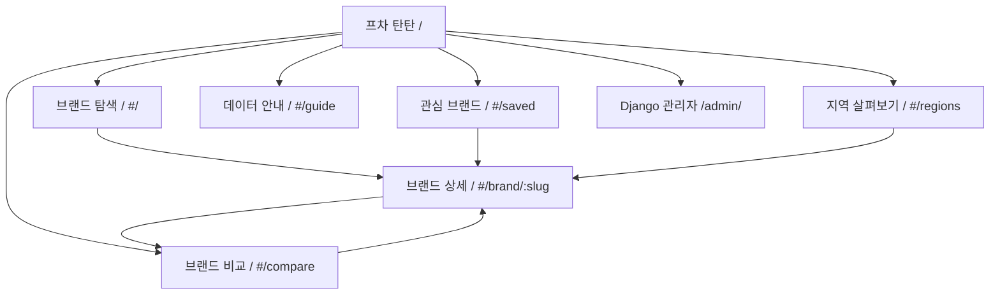

# FCHA TANTAN | 사이트맵 및 메뉴 설계

> 2026-10-13 / 기준 소스: fcha_tantan.zip / 현재는 데모 8개 브랜드(가상 수치)

## 사이트맵

## IA 메뉴 구조

| 우선순위 | 메뉴 | 하위영역 | 현재 경로 | 구현 상태 |
|---|---|---|---|---|
| 1 | 브랜드 탐색 | 통합 검색, 카테고리, 연도, 지역, 정렬, 카드 | `#/` | 구현 |
| 2 | 브랜드 상세 | KPI, 개·폐업 그래프, 지역 매장, 창업비용, 출처 | `#/brand/:slug` | 구현 |
| 3 | 브랜드 비교 | 최대 3개 선택, 동일연도 비교, CSV | `#/compare` | 구현 |
| 4 | 지역 살펴보기 | 17개 광역시·도, 브랜드별 매장수 | `#/regions` | 구현 |
| 5 | 관심 브랜드 | 저장/해제, 목록 | `#/saved` | 구현(localStorage) |
| 6 | 데이터 안내 | 데이터 기준·출처·주의사항 | `#/guide` | 구현 |
| 7 | 데이터 관리자 | 브랜드/연도/지역 레코드 | `/admin/` | Django Admin |

> 주의: 프런트는 Hash Router를 사용하므로 `#/brand/...`는 서버 라우팅이 아님. Django API는 `/api/v1/` 아래에서 별도로 동작.

## 사용자 동선

1. 메인 방문 → 업종(카페/치킨/편의점/미용실) 선택 → 연도(2024/2025) 선택 → 검색.
2. 카드 KPI 확인 → 상세페이지 → 전국 통계 및 지역별 매장분포 확인.
3. 브랜드 1~3개 비교 담기 → 비교 화면 → 데이터 비교 → CSV 내려받기.
4. 관심 브랜드 저장 → 재방문 시 브라우저에서 목록 확인(계정 동기화 없음).

## 공통 내비게이션

- 로고: 홈으로 이동. 상단 메뉴는 브랜드 탐색 / 지역 살펴보기 / 브랜드 비교 / 데이터 안내 / 관심 브랜드.
- 모바일은 화면 크기에 따라 반응형 처리. 키보드 포커스·본문 바로가기 제공.
- 페이지 공통: 데이터 상태(가상/실제), 기준연도, 수치 단위, 출처 및 기준일 분명히 표시.

## 화면별 진입·이탈 및 검수

| 화면 | 대표 진입 | 대표 이탈 | 빈 화면 기준 | 접근성 검수 |
|---|---|---|---|---|
| SCR-01 메인 | 로고/상단 탐색 | 상세/비교/지역 | 검색 결과 없음 CTA | 검색창 레이블·연도 선택 |
| SCR-02 상세 | 브랜드 카드 | 뒤로/비교/안내 | slug 불일치 → 목록 복귀 | KPI 단위·그래프 대체텍스트 |
| SCR-03 비교 | 비교 담기/메뉴 | 브랜드 추가·상세 | 비교 브랜드 0개 CTA | 표 가로 스크롤·행 헤더 |
| SCR-04 지역 | 상단 지역 메뉴 | 브랜드 상세/비교 | 지역 데이터 결측 명시 | 지역 버튼의 선택 상태 |
| SCR-05 관심 | 상단 관심 메뉴 | 탐색/상세/비교 | 저장 0개 vs 필터 0개 구분 필요 | 하트 저장/해제 상태 |
| SCR-06 안내 | 상단 데이터 안내 | 탐색·상세 | 해당 없음 | 용어·정보 구조 |
| SCR-07 관리자 | /admin/ 로그인 | 모델 데이터 수정 | 등록 데이터가 없어도 서버 정상 | 관리자 권한·로그 |

## 디자인 토큰·공통 컴포넌트

- 컬러: navy `#18243A`, lemon `#F4EF76`, white `#FFFFFF` — 상용 UI 구현의 기준이며 인쇄 문서 표지는 가독성 중심으로 단순화.
- UI 블록: GlobalHeader, HeroBanner, YearSelect, CategoryChips, RegionSelect, BrandCard, KPI, TrendChart, CompareTray, Toast, EmptyState, SourceBadge.
- 브라우저 저장 키: `tantan-saved`, `tantan-compare`; 저장한 항목은 브라우저 단위이고 다른 기기에는 연동되지 않는다.
- 화면 연계: 선택 연도는 같은 세션의 상세·비교·지역 화면에서 공유하고, 지역 선택에 따라 변하는 값은 지역 매장 수뿐.
- 2024/2025년 이외의 연도는 해당 데이터가 공급될 때만 노출. 없는 수치의 표기는 0이 아니라 '미제공'.

## 5인 팀 작업 분담 예시

| 역할 | 담당 | 인수인계/검수 산출물 |
|---|---|---|
| 통합·서버 리드 | Django 프로젝트/서버/DB/라우팅/PR 병합 | 브랜치·마이그레이션·통합 테스트 |
| 프런트엔드 | HTML/CSS/반응형/시안 적용 | SCR-01~06 화면 체크리스트 |
| JavaScript | 상호작용/검색/필터/저장/비교 | 클릭 이벤트·브라우저 오류 점검 |
| 데이터 분석 | Pandas 정제, 공공데이터 출처 검증 | 스키마에 맞춘 CSV·품질 보고서 |
| 검증·콘텐츠 | 지표 정의/QA/출처/콘텐츠 | 화면별 케이스·이슈리스트 |

> 위 분담은 추천안이며 현재 코드 기여자 구분을 증명하지 않습니다.
