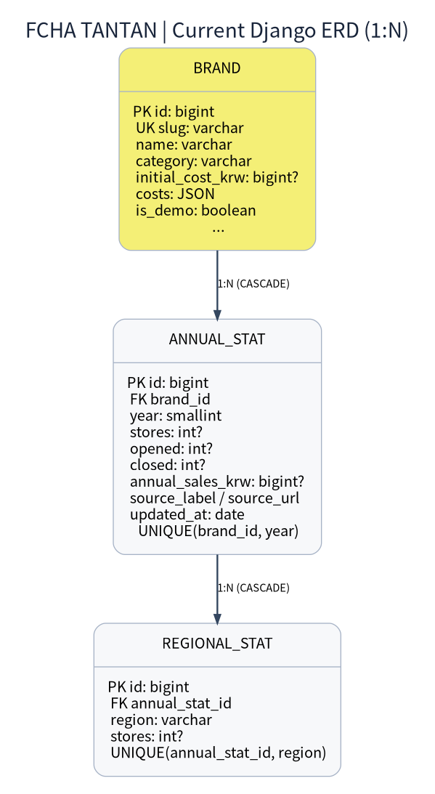

# FCHA TANTAN | 데이터베이스 ERD

## 현재 구현 스키마 (Django brands/models.py의 정확한 구조)





### 관계 / 제약

- Brand (1) : AnnualStat (N), CASCADE; `UNIQUE(brand_id, year)`.
- AnnualStat (1) : RegionalStat (N), CASCADE; `UNIQUE(annual_stat_id, region)`.
- `slug` 유일, 검색과 URL 상세 식별자로 활용.
- region은 전국 17개 행정지역으로 제한하는 서비스단 검증 필요.
- null은 미제공. `opened`, `closed`는 **기준 연도의 발생 건수**, `stores`는 **기준연도 말 재고량**.
- 지역 매장 수 합계와 전국 매장 수의 정합성을 CSV import에서 검증.

## 향후 확장 권장(미구현)


**확장 ERD는 설계 제안이며 현재 DB에는 반영되어 있지 않습니다.**


> 이 확장 엔터티들은 제안이며 `models.py`에 아직 없음. 특히 폐업 정의가 검증되지 않으면 별도 `closure_definition` 등의 출처 메타데이터 추가 권장.

## SQL DDL 개념 예시

```sql
CREATE TABLE brand (id BIGINT PRIMARY KEY, slug VARCHAR(50) UNIQUE NOT NULL, name VARCHAR(100) NOT NULL, category VARCHAR(30) NOT NULL, is_demo BOOLEAN NOT NULL);
CREATE TABLE annual_stat (id BIGINT PRIMARY KEY, brand_id BIGINT NOT NULL REFERENCES brand(id), year SMALLINT NOT NULL, stores INTEGER, opened INTEGER, closed INTEGER, annual_sales_krw BIGINT, source_label VARCHAR(200) NOT NULL, source_url TEXT, UNIQUE(brand_id, year));
CREATE TABLE regional_stat (id BIGINT PRIMARY KEY, annual_stat_id BIGINT NOT NULL REFERENCES annual_stat(id), region VARCHAR(30) NOT NULL, stores INTEGER, UNIQUE(annual_stat_id, region));
```

실제 DB 생성에는 위 예시 DDL이 아닌 `python backend/manage.py migrate`를 사용.


## 데이터 사전: 필드별 사용 기준

| 엔터티 | 필드 | 단위/타입 | 검증 규칙 |
|---|---|---|---|
| Brand | slug | 고유문자열 | URL 식별자; 중복 불가 |
| Brand | category | 문자열 | 카페/치킨/편의점/미용실 중심 분류 |
| Brand | initial_cost_krw | 원, nullable | 예상 총비용과 공식 금액 혼동 금지 |
| Brand | is_demo | boolean | 참이면 시연자료 표시 필수 |
| AnnualStat | year | 연도(int) | 우선 2024·2025 |
| AnnualStat | stores | 개, nullable | 연말 매장 수 |
| AnnualStat | opened / closed | 개, nullable | 해당 연도 발생 건수 |
| AnnualStat | annual_sales_krw | 원, nullable | 연 평균 매출, 순이익 아님 |
| AnnualStat | source_label / source_url | 출처 문자열/URL | 실데이터 수집 시 필수 추적 |
| RegionalStat | region | 지역명 | 허용된 17개 시·도 중 하나 |
| RegionalStat | stores | 개, nullable | 전국 stores와 지역합계 비교 |

## 데이터 무결성 및 마이그레이션

1. `python backend/manage.py makemigrations --check --dry-run`로 모델 변경 여부를 확인한다.
2. `python backend/manage.py migrate`로 초기 스키마를 만든다.
3. CSV 적재 전 브랜드 식별자, 연도, 지역, 합계, 단위, 결측 여부를 검사한다.
4. 동일 브랜드·연도에 대해 `UNIQUE(brand,year)`를 유지한다.
5. 정적 시연용 8개 브랜드는 `is_demo=True`; 실데이터와 섞어 성과 비교하지 않는다.
6. 관리자가 기존 데이터 수정 시 원자료 대조 기록과 검수 책임자를 남기는 이력 테이블은 후속 개발 범위이다.

## SQL 조회 예시 (개념)

```sql
SELECT b.name, a.year, a.stores, a.opened, a.closed, a.annual_sales_krw
FROM brands_brand b
JOIN brands_annualstat a ON a.brand_id = b.id
WHERE b.category = '카페' AND a.year = 2025;
```

> 테이블명은 기본 Django 앱·모델명 기준이며, 실제 이식 시 마이그레이션 결과를 우선 확인할 것.
