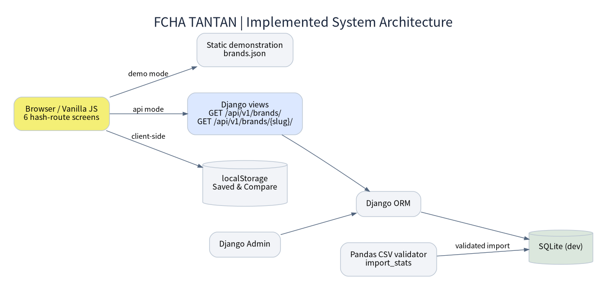

# FCHA TANTAN | 시스템 아키텍처 · URL · 데이터 흐름

## 현재 구조

## 현재 URL 분리

| 종류 | URL | 메모 |
|---|---|---|
| 서비스 메인 | `/` | Django 모드일 때 HTML 반환 |
| 브랜드 탐색 | `/#/` | 클라이언트 라우트 |
| 상세 | `/#/brand/{slug}` | 클라이언트 라우트 |
| 비교 | `/#/compare` | 클라이언트 라우트 |
| 지역 | `/#/regions` | 클라이언트 라우트 |
| 관심 | `/#/saved` | 클라이언트 라우트 |
| 데이터 안내 | `/#/guide` | 클라이언트 라우트 |
| 브랜드 목록 JSON | `/api/v1/brands/` | GET 구현 |
| 브랜드 상세 JSON | `/api/v1/brands/{slug}/` | GET 구현 |
| 관리자 | `/admin/` | Django 관리자 |
| 환경 설정 JS | `/app-config.js` | Django API 모드 지정 |

## 데이터 수집·적재 ETL 설계

1. 공식 정보공개서/공공데이터 출처에서 원본 파일 수집, 출처 URL 및 기준연도 보존.
2. Pandas로 식별자·업종·17개 시도·중복/결측·단위 정규화.
3. 브랜드×연도×지역 CSV 생성. 전국 수치는 17개 행에 반복되며 **절대 합산하지 않음**.
4. `python backend/manage.py import_stats 경로.csv`로 검증 및 원자적 적재.
5. ORM/API 결과와 원자료를 대조하고 데모/실제 혼합 금지 확인.
6. UI에 출처·기준연도·갱신일·미제공 수치 노출.

## 운영 전 체크

- SQLite → PostgreSQL 전환 검토, DEBUG=False, SECRET_KEY 환경변수, ALLOWED_HOSTS, HTTPS, 정적 파일 서빙.
- 접근 로그, 백업 및 복구, 관리자 권한 최소화, 입력 유효성·캐시·레이트 리미팅.
- 브랜드 수가 많아지면 API 서버 측 검색·페이지네이션·정렬/필터 전환.
- 전국 연평균 매출을 지역별 매출로 잘못 표시하지 않기.
- 현재 엔드포인트는 공개 GET뿐이며 로그인/별도의 브랜드 저장 API는 미구현.

## 구성요소 책임과 데이터 이동

| 계층 | 실제 파일 | 처리 기능 | 실패 시 처리 |
|---|---|---|---|
| 뷰 | `dist/index.html`, `dist/css/style.css` | UI 구조/반응형 디자인 | 콘솔·반응형 점검 |
| 상태 관리 | `dist/js/app.js` | 해시 라우트, 비교/관심 localStorage, 렌더링 | 빈 결과/재시도 메시지 |
| 데이터 요청 | `dist/js/api.js`, `dist/js/config.js` | demo JSON 또는 Django API 호출 | 실패 시 UI 재시도 |
| 계산 | `dist/js/data-utils.js` | 필터, 통계, 연매출→월매출 | null·0 구분 |
| API | `backend/brands/views.py` | 전체/상세 데이터 serialize | 404 처리 |
| DB 모델 | `backend/brands/models.py` | Brand, AnnualStat, RegionalStat | UniqueConstraint |
| 적재 | `backend/brands/management/commands/import_stats.py` | CSV 검증/DB 저장 | 실패 시 트랜잭션 취소 |
| 운영자 | `/admin/` | 모델 레코드 확인·수정 | 관리자 권한 확인 |

## 실행 모드의 차이

| 모드 | 진입 주소 | 데이터 원천 | 요구사항 |
|---|---|---|---|
| 정적 미리보기 | `http://127.0.0.1:8080` | `dist/data/brands.json` | Python 기본 HTTP 서버 |
| Django 로컬 | `http://127.0.0.1:8000` | SQLite / Django ORM | 가상환경, migrate, seed_demo |
| 운영(제안) | HTTPS 공개 도메인 | PostgreSQL 등 | 배포설정/보안/로그/백업 필요 |

## 배포 검증 체크포인트

- 개발서버 `runserver`를 인터넷 공개 운영 서버로 사용하지 않는다.
- DEBUG, SECRET_KEY, ALLOWED_HOSTS, 세션 보안, 관리자 계정을 별도 배포 값으로 관리한다.
- 정적 파일 캐시 정책과 데이터 API 갱신 정책을 구분한다.
- `/api/v1/brands/` 대량 조회에서 데이터가 증가할 경우 서버 쪽 페이징·필터·캐시로 전환한다.
- 사용자 계정/계정별 관심 브랜드는 현재 미구현; 로그인 화면을 필수 플로우로 가정하지 않는다.
- 공개 전에 브랜드/매출/폐업의 통계 정의를 출처 원문과 1:1 검증한다.
